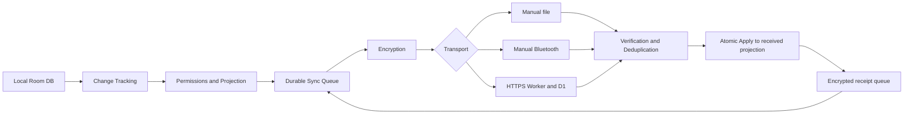

# Ritela Sync: технический план

Дата аудита: 2026-10-15. Основание: текущее дерево после `9679650` и приложенное пользователем задание. Статус: **предложение для согласования**. Код приложения, Room-схемы и облачные ресурсы этим документом не изменяются. Ни один следующий этап не считается разрешённым только фактом появления плана.

Пользователь уже создал Cloudflare D1: `133088c5-c0e6-40b7-b264-af6ef7d1cdd8`. Это идентификатор ресурса, не пароль и не адрес API. Доступность, имя базы, account ID, тариф, регион и её содержимое не проверялись: доступа к аккаунту Cloudflare в этом аудите не было. Повторно создавать базу не требуется; применение миграций и развёртывание Worker — отдельные будущие действия.

## 1. Вывод аудита

Ritela уже умеет безопасно обмениваться отдельными сообщениями между явно подтверждёнными устройствами. Можно сохранить идентичности, доверенные контакты, криптографические примитивы и ручные способы доставки. Однако текущий протокол переносит снимки, а не изменения записей. Добавление HTTP к `prepareData()` не обеспечит синхронизацию: поздний снимок способен заменить более новый, удаления записей не передаются, устойчивой очереди повторов нет.

Предлагается выделить общий Sync Engine и версионированный протокол изменений. Для первой версии — один автор исходных записей на одном устройстве, несколько получателей и устройств доставки; параллельное редактирование собственных записей на нескольких телефонах не включать. Получатель хранит отдельную проекцию владельца и никогда не меняет оригинал. При миграции старые сообщения сохраняются как история; новый протокол включается только после согласования возможностей двух сторон.

## 2. Что есть в коде

Все пути в таблице относительно `app/src/main/kotlin/app/ritela/`, если не указано иное. Проверены реализации, а не только прежние описания в документации.

| Область | Реализация и поведение | Вывод для Sync |
|---|---|---|
| Идентичность профиля | `data/PartnerCrypto.kt`: `LocalPartnerKeys.create()`, `identityId`, `certificate()`; RSA-3072 identity, SHA-256 от public key как ID; отдельные UUID устройства, EC-256 ключ подписи, nonce | Сохранить identity и подтверждённые device keys. Локальный UUID профиля не является identity ID |
| Хранение ключей | `PartnerKeyVault.loadOrCreate()/save()`: переносимые приватные ключи зашифрованы AES-GCM под профильным Android Keystore key; `AtomicFile`. Если wrapping key пропал при существующем файле, выдаётся ошибка | Не создавать молча новую личность при ошибке. Приватные identity/device keys не выдавать relay |
| Приглашение и доверие | `data/PartnerRepository.kt`: `inspectInvitation()`, `pair()`, `acceptKnown()`; RSA-сертификат устройства и EC-подпись приглашения. Новая привязка требует invitation v2 | Повторно использовать. Relay не может автоматически подтверждать нового партнёра/телефон |
| Проверка двух сторон | `data/PartnerPairing.kt`: `pairingContext()/pairingCode()`; полный SHA-256 контекст двух endpoints и nonce; восемь цифр только для отображения. `PartnerDevice.mutualConfirmed` блокирует обмен до подтверждения | Сохранить полный контекст. Не превращать короткий код в пароль API |
| Модель контактов | `domain/Partner.kt`: `PartnerIdentity`, `PartnerDevice`, `PartnerContact`, `PartnerDirectory.add()/merge()/remove()` | Контакт может объединять личности; сеть и права привязывать к каждой личности/устройству, не к имени или карточке группы |
| Права | `ShareScope.permits()/normalized()`, `domain/PartnerSharing.kt`: `remembered()/outgoing()`; `confirmData()` атомарно сохраняет пакет, grants и lastSelection | Сохранить явный выбор. `remembered()` фиксирует ID существующих тегов; новые теги не получают автоматического допуска. `SETTINGS` читается в legacy, но исключён из новых передач |
| Данные и схема | `data/RitelaDatabase.kt`: Room v6, явные миграции 1→2→3→4→5→6. `PeriodEntity`: UUID, createdAt/updatedAt, unique startDay. `DayLogEntity`: ключ epoch-day, без revision/updatedAt. Layout/settings — singleton-строки | UUID периода подходит; timestamp не является порядковой версией. Для дня использовать ключ `(ownerIdentity, day)`. Нужны revisions, журнал и tombstones |
| Запись и удаление | `PeriodRepository`/`PeriodDao`: add/addAll/finish/edit/delete, проверки пересечений. `DayLogRepository.save()`: пустой день физически удаляется. `JournalRepository.save()`, `BackupRepository.import()` также меняют записи | Охватить все пути изменения в одной транзакции с журналом, включая import. Наблюдение за Flow само по себе теряет удаления и промежуточные изменения |
| Формирование пакета | `PartnerRepository.preview()/prepareData()/confirmData()/prepareDoodle()` и private `prepare()` | `preview()` пригоден как проверенная отправная точка фильтрации/первого снимка. Выделить serializer/projector и crypto envelope из большого repository, сохранив ручной API |
| Шифрование | `prepare()`: случайный AES-256 key, IV 12 bytes, AES-GCM/128-bit tag, AAD `ritela.partner:1`; ключ обёрнут RSA-OAEP SHA-256/MGF1-SHA256 получателя; EC/SHA-256 подпись точной строки header | Это E2E envelope, пригодный как база после усиления протокола. Не сертификация безопасности интернет-сервиса |
| Формат | Внешний JSON `header` (строка) + `signature`; header `ritela.partner.encrypted` v1 содержит from/device/to/targetDevice/key/iv/data; зашифрованный body `ritela.partner` v1 содержит UUID, link nonce, kind, created, content | Внешние устойчивые identity/device ID видимы серверу, если загрузить envelope напрямую. Для минимизации метаданных нужен дополнительный внешний слой или явное принятие этой утечки |
| Проверка/дедупликация | `receive()`: размер, адресат/телефон, существующее доверие и enabled, подпись, GCM, совпадение адресов body/header, link nonce, тип и содержимое; `PartnerDao.message(id)`/insert ABORT в транзакции | Переиспользовать проверки. ID защищает от повтора того же сообщения, но не от старого содержимого с новым ID и не от отката локальной БД |
| Inbox/outbox | `data/PartnerStorage.kt`: `PartnerMessage`, `PartnerDao`, JSON-каталог. Таблица хранит исходящие и входящие сообщения, body открытым локально и ciphertext envelope | Это история, а не scheduler: нет attempts, nextAttempt, lease, scope epoch, per-device delivery. Не называть существующую таблицу готовой sync queue |
| Удаление сообщений | `deleteMessage()`, `hide()/erase()/clearReceived()`: ID сохраняется; `hiddenFromChat` введён MIGRATION_5_6 | Сохранять защиту от replay. Локальное удаление пузыря не означает удаление оригинальной записи у владельца или удалённой копии |
| Квитанции | `acknowledgement()`, `receive()` обрабатывают ACK/OPENED с проверкой исходного сообщения/адресата; `openDoodle()` создаёт OPENED для отдельного DOODLE | Переиспользовать смысл квитанций; добавить устойчивую очередь и per-device статусы. Сейчас OPENED для вложенного в DATA дудла протоколом не предусмотрен |
| Дудлы | `domain/Partner.kt`: `Doodle`, `unlockAt()/canOpen()`, лимиты штрихов/точек/подписи; `PartnerCodec.doodle()`, `data/SavedDoodleLibrary.kt`, `domain/SavedDoodles.kt` | Сохранять формат рисунка и локальную библиотеку. AFTER_DAYS отсчитывается от первого локального received, включая часы/минуты; повтор доставки не должен менять это время |
| Файл | `ui/PartnerFiles.kt`, `PartnerExternalFile.kt`, `PartnerViewModel.receiveFile()`, `data/PartnerInvitationFile.kt` | SAF/FileProvider и `.ritela` сохранить. Импорт файла не создаёт автоматический ACK; открытие share sheet не доказывает доставку |
| Bluetooth | `data/PartnerBluetooth.kt`: foreground RFCOMM, `exchangeInvitations()/send()/receive()/close()`, length-prefixed frames (до 4 МиБ), ACK на том же соединении | Это Bluetooth Classic, не Google Nearby Connections и не BLE auto-sync. Существующие `NearbyPhone` — название локальной модели сопряжённых телефонов |
| Режим получателя | `PartnerPreferences` (DataStore), `ui/PartnerHome.kt`/`PartnerReceivedCalendar.kt`, `data/PartnerSnapshot.kt` | Получатель отображает authenticated snapshot без пересчёта прогноза. `partnerDataMessage()` выбирает максимальный local received — для новых дельт это необходимо заменить версионированной проекцией |
| Изоляция | `data/UserProfiles.kt`: `ProfileSession`, отдельные БД, vault, preferences, close/switch/delete; `ui/ProfileApp.kt` | Фоновая задача должна открывать конкретный profile ID, а не текущий выбранный UI-профиль; удаление/переключение должны отменять/закрывать работу безопасно |
| Backup | `BackupRepository` переносит выбранные записи/layout/settings; отдельные `exportIdentity()/restoreIdentity()` в PartnerRepository сохраняют RSA identity | Экспорт identity не сохраняет device key/nonce, контакты, историю или anti-replay state. Restore требует пустого каталога, создаёт новое устройство; это не восстановление всей Sync-сессии |
| Сеть и зависимости | `app/src/main/AndroidManifest.xml`: нет INTERNET; `gradle/libs.versions.toml`: Room/DataStore/Coroutines уже есть, WorkManager/HTTP-клиента нет | Разрешения и сетевой scheduler добавляются отдельным этапом; до согласия никакие обращения к relay не выполняются |

Существующая проверочная база: `PartnerTest`, `PartnerPairingTest`, `PartnerInvitationsTest`, `PartnerVaultTest`, `PartnerReliabilityTest`, `PartnerShareSelectionTest`, `PartnerMessageDeletionTest`, `PartnerExperienceTest`, `UserProfilesTest`, `DayLogBackupTest` в `app/src/test/kotlin/app/ritela/`. Их наличие не означает, что новый Sync уже протестирован; в этом документационном шаге Android-тесты не запускались.

## 3. Границы первой версии

Согласие на ручную передачу не включает интернет и не включает автоматическую отправку будущих записей. Для каждого профиля отдельно сохраняются global Internet Sync enabled, а для каждого адресата — auto-send enabled и точный утверждённый scope. Отправка в группу разворачивается в независимые получатели с независимым шифрованием и правами.

Один профиль-владелец редактирует свои медицинские записи на одном авторском устройстве. Другие сертифицированные устройства могут быть получателями, но не получают автоматически право записи. Переход авторства на новый телефон — отдельная подтверждённая процедура. Если требуется одновременное редактирование на нескольких телефонах, план нужно расширить до причинных версий/конфликтов авторов до реализации этапа 1.

Local-first сохраняется: ошибка сети, истечение TTL и исчерпание облачного лимита не мешают сохранять собственные записи. Bluetooth и файлы работают без включения Internet Sync. Для автоматического обмена рядом предусматривается только интерфейс транспорта; обнаружение BLE/Nearby и фоновая работа рядом сейчас не проектируются.

## 4. Поток данных и границы слоёв

`domain/sync/` содержит чистые Kotlin-модели операций, версии, permission decisions, правила повторов и состояния. `data/sync/` содержит Room entities/DAO, транзакции, криптографию, HTTP и WorkManager adapter. UI подписывается на состояние и вызывает действия; сеть и расчёты не помещаются в composable. Для начала остаётся один Gradle app module: отдельный модуль/DI framework не требуется.

Предлагаемые компоненты: `SyncEngine` координирует durable work; `ChangeRecorder` пишет изменения; `ShareProjector` выдаёт только разрешённое представление; `SyncEnvelopeCodec` кодирует v2; `PartnerEnvelopeCrypto` выделяет существующие crypto operations; `SyncTransport` предоставляет send/fetch/acknowledgeStorage, а ручные адаптеры поддерживают только доступные операции. Отсутствие fetch у file transport — явная capability, а не фиктивный успех.

Пакет и его UUID создаются один раз на адресное устройство. Повтор по другому транспорту передаёт те же bytes, а не заново вызывает `prepareData()` с новым UUID. Общая E2E дедупликация не зависит от HTTP ID, имени файла или Bluetooth-сеанса. Несколько устройств получают отдельные delivery rows для одной логической операции.

### 4.1. Локальные таблицы (проект)

Новые таблицы вводятся явной миграцией от фактической версии Room на момент реализации (сейчас 6). Старые миграции и сообщения сохраняются.

| Таблица | Ключ и назначение |
|---|---|
| `sync_owner_state` | owner identity → author device, generation, следующий sequence. Generation меняется только подтверждённым переходом авторства, не произвольной новой установкой |
| `sync_record_versions` | `(owner, entityType, entityKey)` → revision, deletion flag, digest. Период = UUID; день = epoch-day; layout definitions = section/tag ID; forecasts = отдельная производная сущность |
| `sync_changes` | `(generation, sequence)` → op UUID, entity key, revision, type UPSERT/DELETE, минимальные данные для воспроизведения. Записывается атомарно с исходным изменением |
| `sync_links` | `(peerIdentity, peerDevice)` → protocol version, exact scope, scope epoch, consent flags, route reference, baseline revision, last applied/acknowledged position |
| `sync_outbox` | packet UUID + target device → immutable encrypted bytes, change range, scope epoch, state, attempts, nextAttempt, leaseUntil, error code; unique packet/target |
| `sync_inbox` | `(senderIdentity, senderDevice, generation, packetId)` → digest, receivedAt, result; хранит tombstones после очистки содержимого |
| `sync_received_records` | `(owner, generation, type, key)` → revision, projected value или tombstone; данные получателя отдельно от собственных periods/day_logs |
| `sync_conflicts` | конкурирующие/неожиданные версии и повреждённые разрывы, без удаления прежней применённой записи |

Журнал доступен только локально и очищается после checkpoint/подтверждений всех активных получателей. Не копировать туда полный дневник для каждого партнёра. При compact хранить record revisions/tombstones и floor допустимого cursor: клиент ниже floor обязан получить новый baseline, а не принимать старые пакеты.

### 4.2. Атомарная запись и первоначальный снимок

1. Мутация periods/day_logs/layout/import и соответствующий `sync_changes` выполняются в одной Room transaction. Изменения, не разрешённые адресату, остаются локальными. Outbox может материализоваться позже из сохранённого журнала, без зависимости от живого Flow collector.
2. При явном включении создаётся scope epoch и в согласованном snapshot БД фиксируется watermark W. Формируется только утверждённая проекция по состоянию W; изменения после W накапливаются отдельно.
3. Baseline состоит из manifest, ID частей и digest; применяется атомарно после проверки всех частей. Повреждение/пропажа части не удаляет старую проекцию. Передавать большие снимки порциями, не рассчитывать на одну строку D1.
4. После baseline идут ordered deltas; при отсутствии разрешённой проекции изменения для данного адресата можно пропускать. Поэтому номер глобального журнала не означает, что получатель должен получить все номера. Envelope несёт согласованный per-link sequence и base cursor, не требующий раскрытия запрещённых событий.
5. События смены даты/алгоритма могут менять разрешённый forecast без правки исходной записи: запланировать обновление производной сущности на устройстве владельца. Получатель не рассчитывает прогноз заново. `asOf`, `calculatedAt`, `algorithm` остаются явными.

### 4.3. Дельты, конфликты и удаления

V2 body включает protocol/capability version, logical operation ID, packet ID, identities/devices, полный контекст связи, owner generation, link sequence/base cursor, scope epoch, creation time и список операций с entity key/revision. Все эти поля аутентифицированы. Временная метка используется для отображения, но не выбирает победившую версию.

Для одного автора новая revision побеждает старую; равная revision с иным digest — конфликт/ошибка протокола. Пакет, пришедший раньше зависимостей, сохраняется в ограниченный буфер; запрашивается недостающее или baseline. DELETE — версионированный tombstone. Старый UPSERT не воскрешает удалённую запись. Удаление у получателя не отправляет DELETE владельцу. Для неизвестного авторского устройства/поколения — карантин и подтверждение, без last-write-wins по часам.

Разрешения применяются к проекции, включая названия разделов/тегов и вложения. Для разрешённого дня передаётся полная **разрешённая** версия его полей: снятый тег удаляется из проекции, запрещённые значения не используются даже в hash. Отсутствие категории в дельте не означает её удаление. Сужение scope передаётся отдельным REPLACE_SCOPE/RESET_VIEW и новым baseline, чтобы ранее разрешённое поле не оставалось случайно в актуальном представлении.

Текущий `partnerDataMessage()` с выбором latest received остаётся только legacy-путём. Новый UI читает материализованную Sync-проекцию, а история сообщений остаётся историей. Старый DATA, доставленный после новой дельты, не заменяет Sync-проекцию. Обратный переход в legacy возможен только явным действием с предупреждением об актуальности.

При восстановлении устаревшей локальной резервной копии обычный sequence может откатиться. Из непроверенного старого backup нельзя продолжать прежнее авторское поколение: нужна сверка checkpoint с доверенным устройством либо подтверждённый переход к новому generation и baseline. Relay не является доверенным источником медицинских версий. Полностью обнаружить откат всех локальных копий при отсутствии внешнего доверенного checkpoint невозможно; это ограничение фиксируется в документации восстановления.

### 4.4. Очередь и реальные статусы

Состояния: LOCAL_PENDING → READY → IN_FLIGHT → RELAY_STORED → RECIPIENT_APPLIED → OPENED; отдельно RETRY_WAIT, PAUSED, EXPIRED, CANCELLED, NEEDS_REVIEW. RELAY_STORED означает только приём зашифрованных bytes сервером. «Доставлено» появляется только по проверенному E2E ACK после durable commit у получателя. «Открыто» — только для контента, где есть явное действие просмотра; чтение DATA автоматически его не создаёт.

Получатель одной транзакцией сохраняет inbox ID/digest, применяет операции и создаёт устойчивую исходящую квитанцию. Лишь после commit разрешено удалять серверный пакет. Сбой после commit до HTTP DELETE приводит к повтору без повторного применения; потерянный ACK повторно ставится/переотправляется. ACK/OPENED не создают ответных E2E ACK, иначе получится бесконечная цепочка. Их серверные копии удаляются после durable import.

Для standalone и вложенного дудла заранее определить отдельный logical doodle ID и OPENED target; старые клиенты получают прежнее поведение. `receivedAt` фиксируется первым импортом и сохраняется при replay/рестарте. Отложенное открытие — UX-ограничение на устройстве: ciphertext уже расшифровывается получателем, а перевод часов/модифицированный клиент может обойти задержку. Не обещать криптографический time lock.

Повторы: exponential backoff с jitter, например от 30 секунд до 6 часов, сохранённые attempts/nextAttempt; учитывать Retry-After и сетевое состояние. 401/403 останавливают link до восстановления допуска, 413 требует переразбиения на уровне протокола, 429/5xx повторяются. Lease освобождается по timeout после смерти процесса. Истечение relay TTL не удаляет локальный оригинал: по восстановлении связи отправляется актуальный baseline/дельта с корректной версией. Очередь ограничена по bytes; coalesce допускается для ещё не отправленных superseded record updates, но не для пользовательских посланий и дудлов.

## 5. Криптография и модель угроз

Существующие RSA-OAEP/AES-GCM/EC-подпись обеспечивают основу конфиденциальности и аутентичности при сохранности ключей. Подпись header связывает IV, wrapped key, ciphertext и внешние адреса; body/header дополнительно сверяются. Но протокол v1 не имеет forward secrecy, sequence, expiry, permission epoch и полноценной защиты от rollback. Компрометация RSA identity private key позволяет расшифровать ранее сохранённые пакеты, даже если устройства различаются: `targetDevice` ограничивается проверкой приложения, а AES key обёрнут общим identity RSA.

Предлагаемый переход без перепривязки существующих контактов:

- Оставить identity ID/RSA и подтверждённые EC device keys корнями доверия. Новые возможности и transport keys передавать в подписанном E2E capability exchange через существующий файл/Bluetooth. Несовместимый клиент остаётся в ручном v1; не делать скрытый downgrade v2→v1.
- Для интернет-канала создать отдельные сертифицированные данным устройством transport keys: P-256 ECDH для внешнего шифрования и P-256 signing для API. Не использовать signing key для ECDH и не придумывать криптографический примитив: согласовать стандартный HKDF-SHA256 + AES-GCM envelope и vectors с отдельным security review. В сертификате связать purpose, public key, device, link context, key version и expiry.
- Чтобы Worker не видел v1 `from/to/device`, оборачивать весь внутренний подписанный пакет в дополнительный device-specific encrypted wrapper с ephemeral ECDH, HKDF с domain separation и случайным GCM IV. Адреса и изменения находятся внутри; внешне остаются случайный route ID, delivery ID, key version, ephemeral key и ciphertext. Receiver transport private key хранится локально под Keystore. Это добавляет сложность, поэтому проверка interop обязательна до HTTP-интеграции.
- Внутренний v2 header/body связывают полный контекст, protocol version, generation, scope epoch, sequence, target device, размеры/части manifest. Кодировать подписываемые bytes однозначно; не подписывать один JSON, а проверять его пересобранную версию. Strict UTF-8, ограничения длины/вложенности/числа операций до выделения больших буферов, allowlist алгоритмов/версий; без произвольных algorithm из входа.
- Проверять API-допуск до дорогостоящего приёма, E2E подпись до применения. Неизвестные ключи, несовпадение device/context, конфликт digest и устаревший generation не обновляют данные. Inbox ID/tombstones и watermark сохраняются после локальной очистки истории.

Так можно сохранить доверенные идентичности без обязательной новой привязки **существующих устройств**: они подписывают новые capabilities прежними ключами. Новому/восстановленному телефону всё равно необходимо отдельное одобрение. Внешний ECDH wrapper сам по себе не даёт forward secrecy при компрометации статического receiver key; удаление старых transport private keys после подтверждения/TTL ограничивает окно, но не равно Double Ratchet. Для сильной FS нужен отдельный этап с проверенным ratchet-протоколом/библиотекой. Не внедрять самодельный ratchet в первую версию.

Identity key rotation — отдельное подписанное старым и новым ключом событие с подтверждением пользователем и контактом; при потере/компрометации старого ключа — повторная проверка личности. Device/transport-key revocation закрывает очереди, отключает отправку, отменяет старые outbox и требует новой версии ключей. Запрещено молча восстанавливать отозванное устройство из старого backup.

Cloudflare всё равно видит IP и сетевые/TLS-метаданные, время, частоту и размер запросов, случайные route/device handles и API public keys, факт чтения/удаления, связь отправителя с очередями. Даже wrapper не скрывает граф активности и не исключает корреляцию. Размеры можно округлять до небольших buckets внутри лимита. Имена, email, телефон, категории данных, рисунки, identity keys и medical plaintext не нужны серверу. D1 encryption at rest не заменяет E2E; локальные Room bodies сейчас не зашифрованы этим wire-протоколом.

## 6. Cloudflare relay

### 6.1. Регистрация и API

Worker принимает HTTPS и хранит opaque bytes через D1 binding; Android не обращается к D1 REST API и не получает Cloudflare API token. Сервер не рассчитывает прогноз, не строит дневник и не ищет пользователей по имени.

Для начала — закрытая регистрация по одноразовому activation token, создаваемому оператором; не встраивать общий регистрационный секрет в APK. После регистрации device handle принадлежит отдельному API signing public key. Identity/device certificate проверяется **партнёром внутри E2E**, серверу достаточно proof of possession API key. Открытая регистрация требует отдельной защиты от Sybil/спама; её нельзя считать решённой случайными UUID.

Очереди направленные, изолированы по паре устройств. Получатель создаёт route, выдаёт конкретному доверенному отправителю write capability и принимает его API public key через E2E bootstrap; отправитель подтверждает привязку. До этого отправка запрещена. Read/control доступны только API key владельца; write — назначенному sender key плюс capability, cancel собственного upload — тому же sender. Повторный bootstrap для новой route — допустимый небольшой ручной обмен, без повторного подтверждения уже доверенной личности.

| API (проект `/v1`) | Проверка и эффект |
|---|---|
| `POST /devices` | Одноразовая активация + proof of possession нового API key; выдаёт случайный handle. Погашение token атомарно |
| `POST /routes` | Подпись получателя; owner API key, разрешённый sender API key, hash write capability, expiry, quotas. Ответ не раскрывает чужие маршруты |
| `PUT /routes/{route}/packets/{deliveryId}` | Sender signature + capability; immutable bounded bytes, digest, expiresAt. Повтор того же ID/digest возвращает прежний результат; другой digest → 409 |
| `GET /devices/{handle}/packets?cursor=…&limit=…` | Подпись owner; только его активные очереди, `expiresAt > now`, keyset pagination, общий byte limit. Cursor не даёт доступа к другому handle и не доказывает E2E порядок |
| `POST /devices/{handle}/ack` | Owner signature, bounded список delivery IDs; удаляет только durable-imported ciphertext, сохраняет короткую idempotency tombstone. Это storage ACK, не статус «Доставлено» |
| `DELETE /routes/{route}/packets/{deliveryId}` | Owner или назначенный sender для своих пакетов; idempotent cancel, включая запрос, обогнавший upload |
| `DELETE /routes/{route}` | Owner немедленно закрывает чтение/запись route; sender может закрыть своё направление. Bytes очищаются ограниченными batch |
| `DELETE /devices/{handle}` | Owner signature; закрывает все свои route и удаляет накопленные bytes/credentials; результат операции проверяется повторным запросом |

Подписывать domain/version, method, canonical path/query, body SHA-256, device handle, timestamp и случайный request ID. Проверять допустимое расхождение часов; явная коррекция часов не меняет медицинские revision. Для мутаций записывать request ID/result атомарно с эффектом и сохранять nonce tombstone до окончания replay window. Идемпотентный повтор получает прежний результат. GET не меняет очередь; replay валидного GET в коротком окне может повторно вернуть только тот же доступный ciphertext и не влияет на E2E состояние. Не писать D1 nonce на каждый пустой poll; для требования полного запрета replay чтений понадобится отдельный session/challenge протокол с иной оценкой writes.

Write capabilities — 256-bit random, передаются внутри E2E, сервер хранит только digest/HMAC с server pepper. В URL capability не помещать; bearer без sender signature недостаточен. Все DELETE/ACK ограничены владельцем/отправителем и конкретной route. Закрытие route и upload сериализуются условными SQL-операциями/транзакционным batch: upload не проходит после revoke, а уже прошедший помечается на очистку. Отмена ID оставляет tombstone, чтобы запоздалый upload не воскресил отменённый пакет.

### 6.2. Схема D1 (проект, не миграция)

| Таблица | Поля/ограничения |
|---|---|
| `activation_tokens` | token_hash PK, expires_at, redeemed_by; краткий TTL, cleanup |
| `relay_devices` | random handle PK, api_public_key, key_version, state, created_at; никаких имён/телефонов |
| `routes` | random route_id PK, owner_handle FK, sender_handle FK, capability_hash, state, expires_at, queued_bytes, queued_count, quota_bytes; индекс `(owner_handle, state)` |
| `packets` | monotonic relay_seq INTEGER PK, route_id FK, delivery_id, ciphertext BLOB, digest, bytes, created_at, expires_at; UNIQUE(route_id, delivery_id), индекс `(route_id, relay_seq)` и `(expires_at)` |
| `packet_tombstones` | `(route_id, delivery_id)` PK, digest/result, expires_at; отмены/удаления не хранят payload; срок не меньше срока допустимого upload/retry данного ID |
| `request_nonces` | `(device_handle, request_id)` PK, body_digest, result_code, expires_at; только мутации, индекс expiry |

Использовать bound parameters, FK, CHECK для bytes/count/TTL и атомарное резервирование quota. `D1Database.batch()` выполняет statements транзакционно, но это не API интерактивных Room-транзакций: все conditional updates/insert и проверки числа изменённых строк следует спроектировать и проверить на гонках. Нельзя сначала отдельно проверить лимит, потом отдельно вставить пакет. [D1 batch API](https://developers.cloudflare.com/d1/worker-api/d1-database/).

Предварительные product limits: envelope до 256 КиБ после всех обёрток, HTTP batch response до 512 КиБ, до 32 пакетов/страницу, до 128 ACK IDs, TTL до 7 суток, до 256 pending packets/8 МиБ на route и 16 МиБ на receiving device. Эти числа требуют нагрузочных/UX проверок, не являются лимитами Cloudflare. Большие baseline разбиваются по операциям/частям; слишком большой дудл требует ограниченного multipart E2E manifest, а не обрезания штрихов. Старый `.ritela` до 3 МиБ можно продолжать передавать вручную; его HTTP chunking проектируется явно и ограничивает размер собранного пакета до decrypt.

Просроченные пакеты исключаются из GET сразу по времени. Cron удаляет их небольшими indexed batches, обновляет quotas и чистит expired nonce/tombstone; после сбоя повторяет. D1 не имеет автоматического TTL для этих строк. Контролировать возраст backlog, bytes, rows_read/written, p95 CPU и 429/5xx без route IDs и содержимого в логах. Защита API: глобальный cap registrations, per-device/route/IP rate limits, byte quotas, reject oversized stream, bounded parsing, Retry-After. Память одного Worker isolate не годится для глобального надёжного rate limit: persistent quota решается в D1, а edge rate limiter/WAF — дополнительный слой с отдельно проверенными возможностями тарифа. Подделка IP не должна обходить device/route quota.

Отдельные dev/staging resources или локальный Wrangler D1; существующую пользовательскую базу не использовать как тестовую без проверки её назначения. Не переносить реальные медицинские пакеты в тестовые фикстуры. Не добавлять R2/KV/Durable Objects/FCM в MVP без измеренной необходимости.

### 6.3. Отзыв, удаление и резервные копии сервера

При сужении scope или отзыве в локальной транзакции повышается epoch, запрещаются новые пакеты и отменяются неотправленные; dispatcher перепроверяет согласие непосредственно перед каждым upload. Для уже загруженных запрашивается cancel/закрытие route. При сохранении связи новый разрешённый baseline и REPLACE_SCOPE очищают текущую проекцию получателя. Если upload уже в сети, полностью предотвратить его доставку невозможно: закрытие route, отмена ID и новый epoch уменьшают окно, но не отзывают скачанные bytes.

Отключение всего Internet Sync немедленно прекращает сетевую работу. Если для очистки relay необходим запрос, UI предлагает явное действие «Удалить ожидающие данные с сервера и отключить»; при недоступной сети показывает pending deletion и срок TTL, без ложного сообщения об успешной очистке. Фоновая передача после выключения не продолжается ради скрытого cleanup. Локальное удаление профиля также заранее предлагает удаление relay-очередей; потеря credentials после удаления профиля оставляет серверу TTL cleanup.

Данные, уже расшифрованные/экспортированные получателем, отозвать технически нельзя. Удаление из активных D1-таблиц не обещает немедленного исчезновения из резервных копий: Time Travel хранит историю 7 суток на Free и 30 на Paid. После административного восстановления БД Worker должен оставаться закрытым до повторного применения revocations/deletions из отдельного защищённого operator recovery ledger; иначе восстановление оживит старые маршруты. Сроки хранения ledger и доступ оператора согласовать перед production. [D1 Time Travel](https://developers.cloudflare.com/d1/reference/time-travel/).

## 7. Android и UX

WorkManager добавляется для persistent one-time upload и периодического fetch с network constraint; Room — источник истины о заданиях. При создании записи/doodle сохраняется outbox и ставится unique work по profile ID; приложение при старте восстанавливает scheduler из БД. Название work не содержит medical values/имён. Для профиля off задания не создаются. Для первой версии синхронизируется выбранный профиль; при switch прежняя работа отменяется/дожидается завершения, старый database handle не используется новой сессией. Поддержку фоновой работы всех профилей можно добавить отдельно через registry, без использования active UI repository.

Периодический WorkManager имеет минимум 15 минут и не гарантирует точное время выполнения; Doze, ограничения OEM и force-stop могут задерживать доставку. Стартовое предложение — редкая фоновая проверка раз в час плюс запрос при открытии приложения и отправка после локального действия; foreground poll ограничен по длительности/частоте. Не обещать мгновенный чат. [Android: work requests и constraints](https://developer.android.com/develop/background-work/background-tasks/persistent/getting-started/define-work).

Будущая FCM интеграция допустима только как необязательный сигнал «есть новые пакеты», без sender name, текста, категории, дат цикла или рисунка. Signal не считается доказательством доставки и не заменяет authenticated fetch. Это дополнительный обработчик/метаданные и отдельная зависимость, поэтому сейчас Firebase не добавляется.

В настройках — «Синхронизация»: «Только вручную» по умолчанию; «Через интернет» включается отдельным согласием с объяснением relay/метаданных/задержек; «Автоматически рядом» только как будущий режим, без рабочего переключателя. В карточке личности остаётся «Чем поделиться», рядом отдельный выключенный по умолчанию auto-send, последнее подтверждённое обновление, очередь и история состава передач. Новый тег/раздел требует нового подтверждения; расширение ручного выбора не расширяет auto scope.

Включение показывает получателя и точные категории baseline. Doodles и послания после нажатия «Отправить» автоматически попадают в очередь при разрешённом internet link; черновик редактора не отправляется. Состояния пользователя: «Ожидает отправки», «Отправляется», «Ожидает подтверждения», «Доставлено», «Открыто», «Ошибка»/«Приостановлено». Технические IDs/nonce не показывать в обычном потоке. Последняя проверка сервера и последнее подтверждённое обновление различаются.

UI использует текущие `Theme.kt` tokens и существующие partner screens; все новые строки сразу EN/RU. При реализации применить `ui-quality-audit`, а при изменении отображения forecast/classification — `cycle-prediction-validation`. Текущий запрет пользователя на просмотр UI/PNG/эмулятора действует до нового явного запроса; не генерировать снимки локально ради визуальной проверки.

## 8. Лимиты и расчёт ёмкости

Проверено по первичным страницам Cloudflare 2026-10-15. Free: Workers 100 000 requests/day, 10 ms CPU/request, 128 МБ памяти; D1 5 млн rows read/day, 100 000 rows written/day, 5 ГБ всего, но **500 МБ на одну базу**, до 10 баз, строка/BLOB не более 2 000 000 bytes, до 50 D1 queries за invocation. Индексы и DELETE также увеличивают writes. Это общие лимиты аккаунта, их расходуют и другие приложения. [Workers limits](https://developers.cloudflare.com/workers/platform/limits/), [D1 pricing](https://developers.cloudflare.com/d1/platform/pricing/), [D1 limits](https://developers.cloudflare.com/d1/platform/limits/).

Следующий расчёт — модель нагрузки, а не обещание бесплатной эксплуатации. N пользователей, по одному устройству и одному адресату у каждого; 20 исходящих envelopes/user/day **включая E2E квитанции**, средний итоговый ciphertext 8 КиБ; 24 poll/day; для каждого envelope один upload и один storage ACK/DELETE request (без batching), плюс 4 control requests/user/day. Получается примерно `68N + 24` requests/day с hourly cleanup. Write budget оценён как 12–20 billable row writes на envelope за полный цикл с nonce/tombstone/index maintenance, то есть `240–400N/day`; это предварительный диапазон, который необходимо заменить замером D1 meta на реальной схеме. Reads ориентировочно `200–500N/day` при индексах, без scan всех packets.

| Пользователи | Worker requests/day | D1 writes/day (оценка) | D1 reads/day (оценка) | Ciphertext за 7 дней без получения | Оценка Free |
|---:|---:|---:|---:|---:|---|
| 2 | 160 | 480–800 | 400–1 000 | 2,29 МБ | Подходит для закрытого пилота, CPU надо измерить |
| 100 | 6 824 | 24 000–40 000 | 20 000–50 000 | 114,69 МБ | Вероятно помещается, с запасом под metadata и CPU |
| 1 000 | 68 024 | 240 000–400 000 | 200 000–500 000 | 1,147 ГБ | Не помещается по writes и одной Free D1 |
| 10 000 | 680 024 | 2,4–4 млн | 2–5 млн | 11,469 ГБ | Не помещается по requests/writes/storage |

МБ/ГБ в таблице десятичные; payload `N × 20 × 8192 × 7`, без индексов, tombstones, устройств и SQLite overhead. Семь дней — offline backlog stress, не обычное steady-state: при удалении за сутки payload в семь раз меньше. Первичная передача истории и сложные дудлы могут быть гораздо больше 8 КиБ. При двух устройствах/нескольких партнёрах fan-out умножает uploads, bytes и квитанции. Poll каждые 15 минут даёт уже `140N + 24` requests/day; при N=1000 превышает Free даже без foreground activity. Minute polling одного устройства — 1440 пустых запросов/day, поэтому его нельзя включать постоянно.

100 пользователей — разумный пилот, а не верхняя гарантированная ёмкость: 10 ms CPU могут оказаться первым ограничением при подписи, хешировании и больших envelopes. Cron на Free также ограничен CPU; cleanup должен быть мелким. Перед публичным запуском снять p95 CPU и rows_read/written на пустом poll, insert, import ACK, retry, cancel и expiry sweep. Держать запас минимум 30% и останавливать приём до hard quota с понятной ошибкой и сохранённой локальной очередью.

Paid D1 допускает 10 ГБ на базу; сценарий 10 000 пользователей с семидневным backlog уже превышает и этот предел до overhead. Это повод уменьшать retention/объём или проектировать несколько tenant shards, а не обещать бесконечный рост одной базы. Переход на Paid и стоимость согласовать по фактическим метрикам и действующим тарифам на дату внедрения; сейчас платные ресурсы не включаются. [D1 limits](https://developers.cloudflare.com/d1/platform/limits/).

## 9. Этапы реализации после согласования

Пути ниже — предлагаемые новые файлы, если компонент отсутствует сейчас. Каждый этап заканчивается отдельными небольшими проверенными коммитами, документацией и сохранением старого ручного обмена. Точные версии новых зависимостей проверяются перед добавлением; текущие версии не меняются ради плана.

### Этап 1. Модели, инварианты и миграция

Файлы: `domain/sync/SyncModels.kt`, `data/sync/SyncStorage.kt`, `data/RitelaDatabase.kt`, `data/UserProfiles.kt`, `app/schemas/app.ritela.data.RitelaDatabase/`, `docs/DATA_FORMAT.md`. Уточнить single-author/generation, scope epochs и совместимость; добавить sidecar revisions, links и новые sync-таблицы без переименования существующих UUID/day keys. Миграция и backfill не включают sync и не отправляют данных. Зависимости: существующие Room/KSP/Coroutines.

Тесты: v6→новая схема, полный migration path, сохранение periods/day_logs/messages/grants/hidden IDs; новый пустой профиль, два профиля, повторное открытие, откат транзакции backfill. Готовность: схема экспортирована, старые данные совпадают, flags выключены. Риск: изменение исходных DAO в обход журналирования; предусмотреть последующий единый путь мутаций. Старые миграции остаются.

### Этап 2. Change Tracking и устойчивый Sync Engine

Файлы: `domain/sync/SyncEngine.kt`, `data/sync/ChangeRecorder.kt`, `SyncQueueRepository.kt`, `ShareProjector.kt`; `PeriodRepository.kt`/`PeriodDao.kt`, `DayLogRepository.kt`/`DayLogDao.kt`, `JournalRepository.kt`, `BackupRepository.kt`, `ProfileSettings.kt` при необходимости. Запись + журнал атомарны; snapshot watermark, per-link cursors, очередь, lease/backoff и coalescing. Начать с fake/in-memory transport; сеть не нужна. Зависимости: существующие Room/Coroutines, внедряемые Clock/random для тестов.

Тесты: kill/reopen между каждым commit/dispatch, запись во время baseline, bulk add, снятый тег/пустой день/DELETE, import, новое разрешение/новый тег, ошибки сериализации, очередь двух профилей. Готовность: ни одно подтверждённое изменение не теряется, запрещённые поля не попадают в payload, restart восстанавливает работу. Риск: рост журнала — compaction только с checkpoint/floor. Старые ручные API работают.

### Этап 3. V2, приём и актуальная проекция

Файлы: `data/sync/SyncEnvelopeCodec.kt`, `SyncApplyRepository.kt`, `domain/sync/SyncConflict.kt`, `data/PartnerRepository.kt`, `PartnerSnapshot.kt`, `PartnerStorage.kt`, `domain/Partner.kt`, `docs/PARTNER.md`. Реализовать capability negotiation, baseline chunks, immutable packet IDs, per-link sequence, UPSERT/DELETE, scoped reset, ACK/OPENED и per-device status. Подготовить `SyncTransport` и ручные адаптеры. Полученные записи хранятся отдельно. Зависимости: текущие JCA/Room; отдельная библиотека сериализации только при доказанной необходимости.

Тесты: одинаковый пакет file+Bluetooth, reordered/duplicate/missing parts, duplicate ID с иным digest, старый snapshot после delta, tombstone replay, scope narrowing, два устройства, restore старого backup, ACK до/после удаления, вложенный doodle OPENED и delayed receivedAt. Готовность: порядок доставки не откатывает проекцию, собственные записи не меняются, v1 остаётся читаемым и не перехватывает активную v2 проекцию. Риск: старый клиент не понимает v2 — явная несовместимость и ручной v1 без скрытого downgrade.

### Этап 4. Защищённый relay и протокол доступа

Файлы: будущий `relay/src/index.ts`, `auth.ts`, `routes.ts`, `packets.ts`, `cleanup.ts`, `relay/migrations/0001_relay.sql`, `relay/wrangler.jsonc`, `relay/test/`; Android `data/sync/PartnerEnvelopeCrypto.kt`, `RelayKeyVault.kt`. Уточнить canonical request bytes, ECDSA DER↔WebCrypto representation, ECDH/HKDF vectors, transport certificates и внешний wrapper. Реализовать local Worker, auth/quotas, идемпотентность, TTL/revoke/delete; привязать существующий D1 ID только после проверки назначения базы. Зависимости: dev-only TypeScript/Wrangler и Workers test runner с локальной D1; pin lockfile. Серверный runtime — WebCrypto/D1, без framework по умолчанию.

Тесты: Kotlin↔Worker vectors, forged sender/read/control, guess route, replay mutations, concurrent quota uploads/revoke/cancel-before-upload, expiry, 413/429, SQL parameterization, rollback batch, восстановление D1 с revoke ledger, отсутствие payload/capability в логах. Готовность: security review threat model и crypto encoding, измеренные CPU/rows/bytes; отдельный staging smoke test разрешается перед облачным выполнением. Риски: 10 ms CPU, Sybil, race cleanup, transport key loss. Production deploy не входит в одобрение локальной реализации автоматически.

### Этап 5. Android HTTP и фоновое выполнение

Файлы: `data/sync/HttpRelayTransport.kt`, `SyncWorker.kt`, `SyncScheduler.kt`, `UserProfiles.kt`, `RitelaApplication.kt`, `AndroidManifest.xml`, `gradle/libs.versions.toml`, `app/build.gradle.kts`; `scripts/verify-apk.ps1` и документы приватности, если они проверяют прежнее отсутствие INTERNET. Добавить INTERNET/ACCESS_NETWORK_STATE по необходимости, WorkManager, HTTPS allowlist endpoint и запрет cleartext; при достаточности использовать платформенный `HttpsURLConnection` в IO с timeout/cancellation, иначе обосновать один HTTP client. Не добавлять общий сетевой слой ради единственного endpoint.

Тесты: process death, Doze/constraints через scheduler test driver, отсутствие сети, timeout/429/5xx, повреждённый ответ, partial fetch, смена/удаление профиля во время работы, выключение global/peer до upload, отсутствие любого запроса до opt-in. Готовность: запись офлайн работает, queue переживает restart, HTTPS пакет подтверждён только после E2E apply. Риск: background delays и отмена blocking IO — обрабатывать закрытием соединения. Старый manual mode без scheduler продолжает работать.

### Этап 6. Автоматическая доставка записей, посланий и дудлов

Файлы: `PartnerViewModel.kt`, `PartnerRepository.kt`, `domain/SavedDoodles.kt`, `data/sync/SyncQueueRepository.kt`, `SyncApplyRepository.kt`. Подключить подтверждённое send action к очереди, автопроекцию разрешённых изменений, forecast refresh, E2E receipts и delayed-open. Draft и saved doodle library не отправляются автоматически. Зависимости: уже добавленные, без FCM.

Тесты: серия правок офлайн/удаление до отправки, действие «Отправить» ровно один раз после restart, повторы по двум транспортам, delayed-open с часами/минутами, дудл в DATA, потерянный ACK, expiry и resync. Готовность: нет ручного создания файлов при включённом internet link, получатель не видит запрещённого, статус не опережает подтверждение. Риск: дублирование старого ручного send flow; один общий pipeline и явное направление каждого сообщения.

### Этап 7. Настройки и прозрачность

Файлы: `ui/SettingsScreen.kt`, `PartnerScreen.kt`, `PartnerSharing.kt`, `PartnerSecuritySettings.kt`, `PartnerConversation.kt`, `PartnerFormatter.kt`, будущие `SyncSettings.kt`/`SyncQueueScreen.kt`, `res/values/` и `values-ru/`. Реализовать независимые consent/scope/auto toggles, baseline preview, состав/очередь/последний успех, ошибки и удаление relay-данных. Применить `ui-quality-audit`; новых UI библиотек не требуется.

Тесты взаимодействий: opt-in/cancel, смена личности в группе, расширение ручного scope без расширения auto scope, revoke offline, выключение с pending deletion, narrow/large text EN/RU по semantics/layout проверкам. Готовность: пользователь различает создание файла, хранение сервером и E2E доставку; отсутствуют обещания удалённого стирания уже прочитанного. Визуальная проверка только после отдельного разрешения пользователя; до неё limitation отмечается явно.

### Этап 8. Надёжность, нагрузка и подготовка выпуска

Файлы: `app/src/test/kotlin/app/ritela/*Sync*Test.kt`, будущие `relay/test/`, CI workflows, `docs/TESTING.md`, `docs/PARTNER.md`, документы backup/privacy, `docs/STATUS.md`. Выполнить recovery matrix, protocol fuzz/property tests с bounded payloads, профилирование CPU/bytes/row metrics и пилот на двух устройствах после отдельного запроса на устройство. Тестовые данные синтетические, production содержимое не собирается.

Критерии: migration/storage tests, tamper/replay/out-of-order/revoke и cross-transport tests проходят; форматирование, debug build и lint без ухудшений; отсутствие plaintext/secret logging; проверена install/update и backout стратегия (отключить Sync, сохранить данные и историю; не destructive downgrade Room). Android-изменения проверяются через `ritela-android-check` с действующими ограничениями пользователя. UI/эмулятор не запускаются до нового запроса. Релиз допускается после отдельного решения по нерешённым security/UX ограничениям; включение платного тарифа и публикация отдельно.

## 10. Что требуется от владельца проекта

Сейчас — согласовать план и ограничения первой версии: один автор, редкая фоновая проверка, TTL 7 суток, закрытый пилот, отсутствие полной forward secrecy. Выбрать, обязателен ли для первого выпуска внешний wrapper для сокрытия identity ID; рекомендация — обязателен, поскольку прямой v1 envelope раскрывает устойчивые идентификаторы Cloudflare. Утвердить поведение очистки прежних данных при сужении scope и правила восстановления авторского поколения.

Перед будущим staging: сообщить имя и назначение уже созданной D1, account ID и тариф, выбрать workers.dev/свой домен и разрешённое размещение данных, выделить тестовую среду, утвердить retention и предел затрат. Доступ настраивается локально через Wrangler/OAuth либо scoped deployment token с минимальными правами Workers/D1; секреты не присылать в чат и не коммитить. ID базы уже известен. Android не получает операторские Cloudflare credentials.

Перед production: получить результаты независимого security review, определить поддержку потерянных ключей/телефона, сохранить шифрованный identity export отдельно от медицинского backup, утвердить operator recovery ledger и действия при quota outage. Включение Sync добровольно у каждого участника; разрешение владельца проекта на deploy не является согласием пользователей на передачу их данных.

## 11. Альтернативы и открытые вопросы

| Вариант | Оценка |
|---|---|
| Загрузить нынешний `.ritela` в HTTP без нового движка | Подходит только для ручного relay-прототипа; не решает порядок, удаления, queue и согласия. Не выбирать как реализацию Sync |
| Полные снимки при каждой правке | Проще дельт, но увеличивает утечки/объём, размер пакетов и риск отката. Использовать только baseline/resync |
| Дельты с одним автором | Рекомендуется для первой версии: однозначные revisions и управляемое восстановление |
| Multi-writer/CRDT сейчас | Значительно усложняет медицинские конфликты и импорт. Отложить до явной потребности; версии первой схемы должны уметь обнаруживать конкуренцию |
| Один RSA envelope без внешнего wrapper | Меньше кода, сохранение существующего trust; сервер видит stable IDs и нет device-key cryptographic isolation. Только после явного принятия ограничений |
| Ratchet/готовая E2E библиотека | Может дать FS, но требует оценки поддержки minSdk, восстановления, лицензии, trust migration и зависимости. Отдельный дизайн вместо заявления, что текущий v1 уже обладает FS |
| FCM/WebSocket/частый polling | FCM — будущий wake-up; постоянный WebSocket и частый background polling не выбирать для начального Android MVP |

Открыто до реализации: требования к одновременному редактированию на нескольких телефонах; допустимая задержка доставки; независимая экспертиза криптографии и угроз rollback; максимальные реальные размеры baseline/дудлов; политика локального удаления полученной проекции, чтобы resync не восстановил её против желания пользователя; доступность Cloudflare в целевых сетях; требования к региону и срокам резервных копий. Для последнего нужен отдельный review политики обработки данных, этот технический аудит его не заменяет.

Проверки этого документа: аудит перечисленных файлов и manifest/dependencies, чтение актуальных первичных источников, workspace validation и diff checks. Аккаунт Cloudflare, рабочая D1, сетевой протокол, UI и Android-сборка этим шагом не проверены. Следующее действие — согласование плана пользователем; реализация и сервер не запускались.
